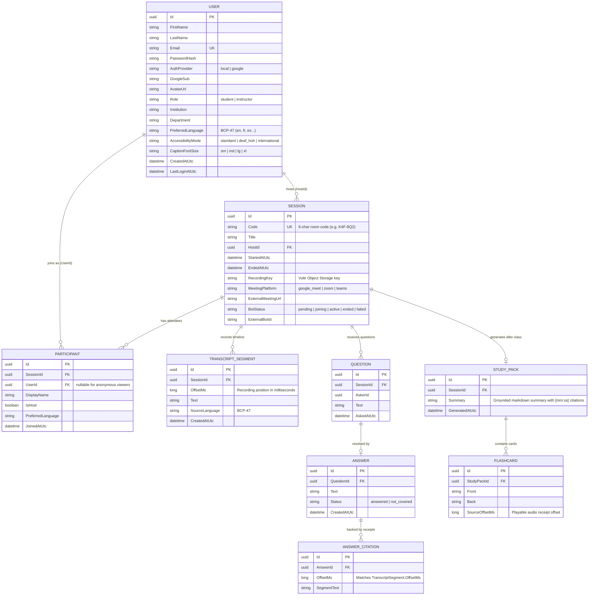

# Levvy — Data Model & Entity Guide

Levvy uses **PostgreSQL** (`Npgsql` via Entity Framework Core 9) as its relational persistence engine, hosted on **Vultr Managed Databases for PostgreSQL**, paired with **Vultr Object Storage** (S3-compatible) for WebM audio recordings.

---

## 1. Entity-Relationship Diagram (ERD)

---

## 2. Domain Entity Guide (`backend/src/Levvy.Domain/Entities`)

### `User`
Represents an authenticated student or instructor.
- Supports both email/password (`PBKDF2-SHA256` with per-user salt) and Google Sign-In (`GoogleSub`).
- Stores personal defaults (`PreferredLanguage`, `AccessibilityMode`, `CaptionFontSize`) that automatically pre-configure the live session workspace.

### `Session`
The aggregate root for a lecture room.
- Identified externally by a human-friendly 6-character code (`Code`, e.g., `K4F-8Q2`) and internally by `Id` (`Guid`).
- `HostId` binds ownership to the creator so `/dashboard` separates **Hosted by you** from **Joined lectures**, and `HostAccess` enforces host-only actions (`ws-ticket`, audio upload, ending a lecture).
- `RecordingKey` points to the WebM recording object in Vultr Object Storage (`recordings/{sessionId}.webm`).

### `Participant`
Tracks everyone who joins a session (`IsHost` or viewer) and their `PreferredLanguage`. When an authenticated user joins (`POST /sessions/{code}/join`), `UserId` links the session to their student dashboard history.

### `TranscriptSegment`
One finalized utterance from the lecture.
- `OffsetMs` anchors the sentence to the exact millisecond in the lecture recording.
- Written via an idempotent, append-only query (`SessionRepository.AppendSegmentIfMissingAsync`) triggered by Hangfire so high-frequency captioning never locks the full `Session` graph.

### `Question`, `Answer`, and `AnswerCitation`
Models the **Ask Levvy** mid-lecture Q&A flow:
- Every `Answer` has `Status = "answered" | "not_covered"`.
- `GroundingVerifier` guarantees that `Status == "answered"` only when at least one `AnswerCitation.OffsetMs` matches a real `TranscriptSegment.OffsetMs` within `±1000ms`.

### `StudyPack` and `Flashcard`
Generated automatically when a lecture ends (`POST /sessions/{id}/end`) or on-demand by a student (`POST /sessions/{code}/pack/generate`):
- `StudyPack.Summary` contains key takeaways with `[mm:ss]` citations.
- Each `Flashcard` carries a `SourceOffsetMs` receipt so students can click the timestamp on the back of any card to hear the lecturer explain that concept.
