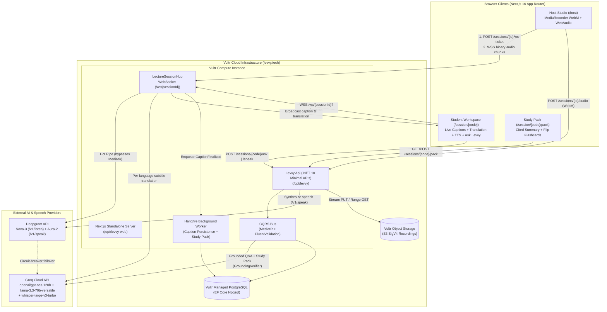
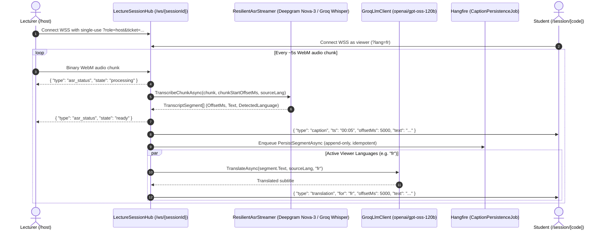
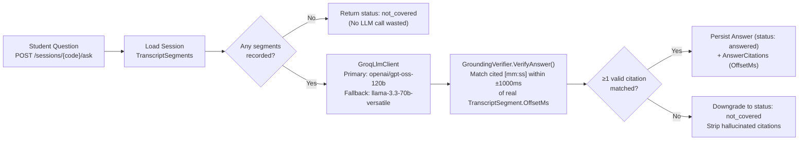
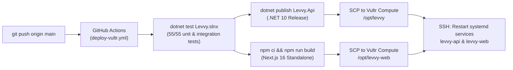

# Levvy — Diagrams as Code (Mermaid)

All diagrams render natively on GitHub.

---

## 1. End-to-End System Architecture

---

## 2. Live Audio Hot Pipe & Translation Fan-Out

---

## 3. Strict Grounding Pipeline (`cite-or-say-not-covered`)

---

## 4. CI/CD Deployment Pipeline to Vultr

