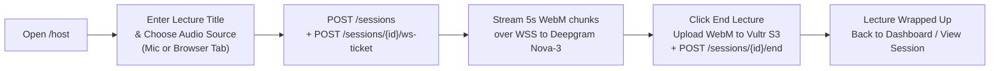
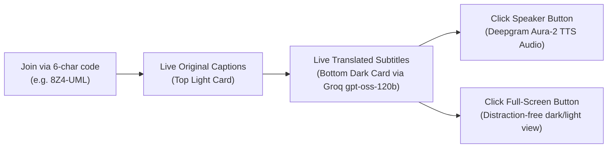

# Levvy — User Flows & Walkthroughs

This guide walks through Levvy's core user journeys across Host and Student roles.

---

## 1. Authentication & 7-Day Session Persistence (`/login`, `/signup`)

1. Users sign up or log in via **Email & Password** or **Google Sign-In**.
2. The **"Keep me signed in for 7 days"** checkbox (enabled by default) stores the session token in `localStorage` with a 7-day expiration cap matching the backend's `10080`-minute JWT lifetime (or `sessionStorage` when unchecked).
3. Selecting **Sign out** on `/dashboard` invokes `clearAuth()`, wiping both `localStorage` and `sessionStorage` and redirecting to `/`.

---

## 2. Hosting a Live Lecture (`/host`)

1. **Create & Connect:** The instructor opens `/host`, enters the course title (e.g., *CSC 319*), selects **Microphone** or **Tab / System Audio**, and starts the lecture.
2. **Scoped Host Ticket:** The frontend requests a 30-second single-use ticket (`POST /sessions/{id}/ws-ticket`) and opens `wss://.../ws/{sessionId}?role=host&ticket=...`.
3. **Dual MediaRecorder Pipeline:**
   - Recorder 1 emits independent 5-second `audio/webm` chunks over the WebSocket to **Deepgram Nova-3** (`/v1/listen`).
   - Recorder 2 captures the continuous lecture recording for playback.
4. **Host Wrap-Up:** When the instructor clicks **End lecture**, the continuous recording uploads to **Vultr Object Storage** (`POST /sessions/{id}/audio`), the session is marked ended (`POST /sessions/{id}/end`), and the host sees a dedicated **Lecture wrapped up** studio summary (**Back to dashboard** or **View session**) rather than student study cards.

---

## 3. Student Live Workspace: Captions, Translation, TTS & Full Screen (`/session/[code]`)

1. **Joining:** A student enters the 6-character room code on `/` (or clicks a shared room link/QR code) and selects their preferred target language (e.g., *Français*, *Español*, *Deutsch*).
2. **Synchronized Dual-Card View:**
   - **Top Card (Light):** Displays real-time original captions with auto-detected source language (`Auto-detect (Deepgram)`) and speaker labels.
   - **Bottom Card (Dark Charcoal):** Displays real-time translated subtitles powered by **Groq (`openai/gpt-oss-120b`)**.
3. **Read-Aloud TTS (Speaker Button):** Clicking the speaker icon on either the original card or the translated card calls `POST /sessions/{code}/speak` (**Deepgram Aura-2 TTS** with automatic language voice selection, e.g. `aura-2-agathe-fr` for French) and plays the synthesized audio aloud.
4. **Full-Screen Mode:** Clicking the expand icon on either card enters native browser full-screen mode with explicit background/foreground styling and responsive `clamp()` typography for lecture-hall readability.

---

## 4. Grounded "Ask Levvy" Q&A & Audio Receipts

1. While the lecture is live (or during review), a student types a question into the bottom **Ask Levvy** bar.
2. The backend queries **Groq (`openai/gpt-oss-120b`)** over the session's `TranscriptSegments` and runs `GroundingVerifier`:
   - **Covered in class:** Returns the explanation along with clickable `[mm:ss]` receipt chips (`status: "ok"`). Clicking a chip seeks the **Lecture recording** player to `offsetMs / 1000` and plays the lecturer's exact words from **Vultr Object Storage**.
   - **Not covered yet:** Returns an honest `not_covered` badge instead of hallucinating outside knowledge.

---

## 5. Student Post-Class Study Pack & Role-Aware Dashboard (`/session/[code]/pack`, `/dashboard`)

1. **After Class Ends:** On the student session page (`/session/[code]`), the right-rail card updates to **Open study pack & flashcards**.
2. **On-Demand or Automatic Generation:** On `/session/[code]/pack`, if the background job is still queued or the student wants to generate immediately, clicking **Generate study pack & flashcards** calls `POST /sessions/{code}/pack/generate`.
3. **Interactive Review:** Students review the cited lecture summary and keyboard-accessible flip flashcards (`Space` / `Enter` to flip), each anchored to a playable `[mm:ss]` audio receipt.
4. **Role-Aware Dashboard (`/dashboard`):**
   - **Hosted by you:** Shows sessions where `session.hostId === user.id` with a `Host` badge and `Manage session` link (no student study-pack clutter).
   - **Joined lectures:** Shows lectures the user attended as a student, with direct links to `Open session` and `Study pack`.
